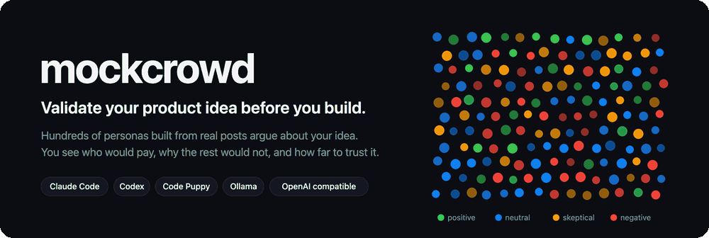
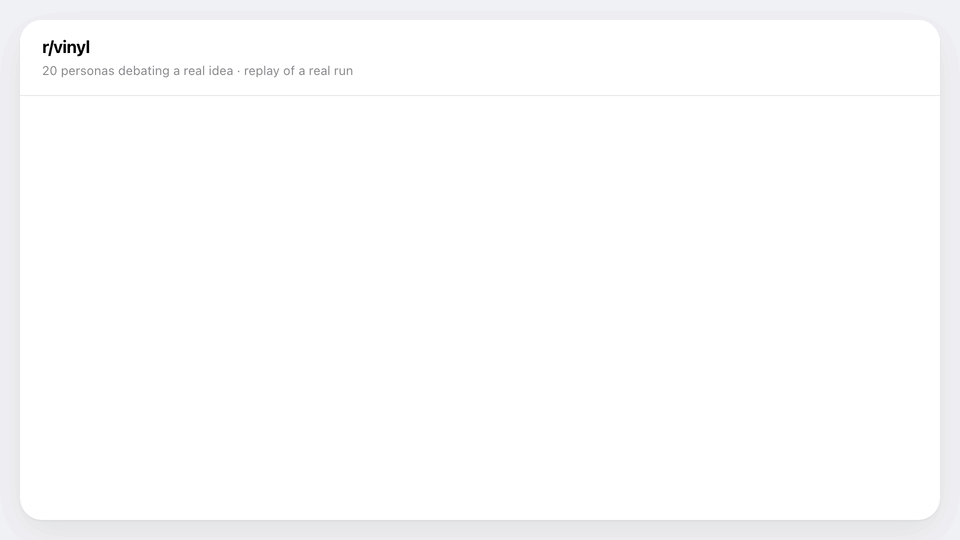
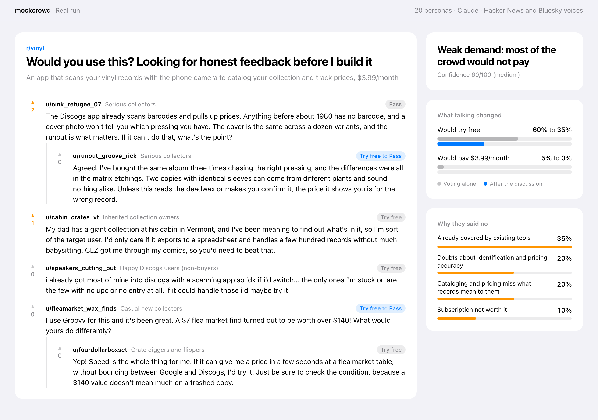
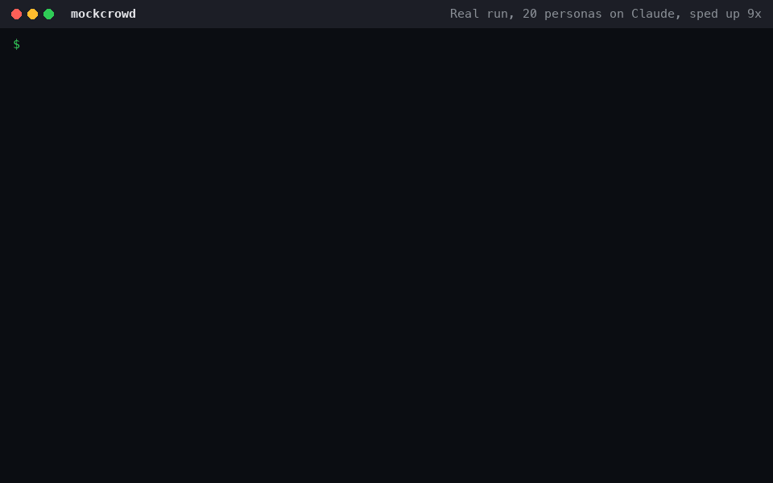
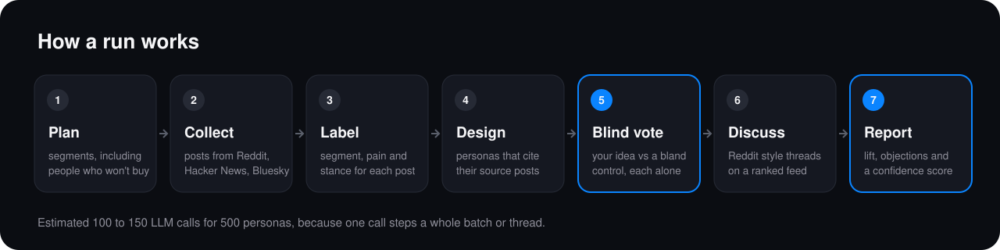

<p align="center"></p>

[](https://github.com/phanisaimunipalli/mockcrowd/actions/workflows/ci.yml)  

<p align="center"></p>

**Validate your product idea before you build.** mockcrowd builds a crowd of hundreds of AI personas from real posts on Reddit, Hacker News and Bluesky, lets them argue about your idea in a simulated Reddit thread, and tells you how many would really pay, why the rest would not, and how far to trust the answer.

It runs on your machine, on the AI you already have: Claude Code, Codex, Code Puppy, Ollama, or any OpenAI compatible API.

```bash
mockcrowd validate "An app that scans your vinyl records with the phone camera to catalog your collection and track prices" --price "\$3.99/month"
```

Real output from a small test run (20 personas, 1 discussion round, Claude, Hacker News and Bluesky voices):

<p align="center"></p>

<p align="center"></p>

Alone, 60% said they would try it free and 5% would pay. After the discussion, 35% would try it and nobody would pay. That is the kind of answer you want before you spend a month building.

## Why it is different

| Problem with asking an LLM "would people buy this?" | What mockcrowd does |
|---|---|
| Models are agreeable and say yes to everything | Every persona also rates a **bland control pitch** in the same blind vote. The verdict is the lift over the control, not the raw yes rate. |
| Invented personas sound like marketing copy | Every persona is **built from real posts** and cites them. The stance mix of the crowd (positive, neutral, skeptical, negative) is matched to the mix measured in those posts. |
| One voice, no social dynamics | A **Reddit style discussion**: threads of about 20 personas, a ranked feed, and a fixed action space (comment, reply, upvote, downvote, do nothing), following the design of [OASIS](https://github.com/camel-ai/oasis). You see the vote before and after people talk. |
| No way to know if the tool is right | **Evals and a backtest** on products with known outcomes (crowdfunding records and well known flops), plus your own recorded outcomes. |

## Install

```bash
pip install mockcrowd
# or: uv tool install mockcrowd
mockcrowd brains        # shows which AI it can use
```

Python 3.10 or newer. One small dependency (`certifi`).

Once a day mockcrowd checks PyPI and prints one line when a newer version is out. It never installs anything. Upgrade with `pip install -U mockcrowd` or `uv tool upgrade mockcrowd`. Turn the check off with `MOCKCROWD_NO_UPDATE_CHECK=1`.

## Pick the brain

mockcrowd uses the first one it finds, or the one you pass with `--brain`.

| Brain | How it runs | Setup |
|---|---|---|
| `claude` | `claude -p` on your Claude Code plan | Claude Code installed |
| `codex` | `codex exec` on your ChatGPT or API plan | Codex CLI installed |
| `code-puppy` | `code-puppy -p` with your configured model | Code Puppy installed |
| `ollama` | Local models, free and private, slower | `ollama serve`, then `--model <name>` |
| `openai` | Any OpenAI compatible endpoint (OpenAI, OpenRouter, LM Studio, vLLM) | `MOCKCROWD_API_BASE`, `MOCKCROWD_API_KEY`, `--model` |

Claude has been run live end to end. The Codex, Code Puppy, Ollama and OpenAI adapters are tested against the flags and API each tool documents, but not yet in a live run; reports are welcome. Claude and Code Puppy run with tools off. Codex runs in its read only sandbox, which blocks writes but not reads, so prefer the others if your machine holds sensitive files.

`--model` is passed through exactly as you write it. A 500 persona run makes roughly 100 to 150 LLM calls, because one call steps a whole batch or thread of personas. A faster, cheaper model makes runs quicker. `OPENAI_API_KEY` is only used with api.openai.com; other endpoints need `MOCKCROWD_API_KEY`.

## Real voices

| Source | Key needed | Notes |
|---|---|---|
| Reddit | Yes, free | Create a "script" app at reddit.com/prefs/apps and set `REDDIT_CLIENT_ID` and `REDDIT_CLIENT_SECRET`. Reddit blocks keyless requests. Free access is for non-commercial use. |
| Hacker News | No | Comments through the Algolia search API |
| Bluesky | No | Public post search |
| GitHub | No | Issues and their top comments, only when the audience is developers. Set `GITHUB_TOKEN` for a higher rate limit. |
| App Store | No | Opt in with `--source appstore`. Apple's public review feed returned no reviews when last tested. |
| Anything else | | X, Threads, Instagram, Discord, surveys, support tickets, interview notes: put the posts in a file and pass `--voices posts.jsonl` (JSONL, CSV or text). |

Each source that fails is listed in the report, and the confidence score drops when evidence is thin.

## Use it from your coding agent

```bash
mockcrowd install-skill                    # Claude Code: ~/.claude/skills/mockcrowd
mockcrowd install-skill --dir <skills dir> # any agent that reads SKILL.md files
```

Then ask: *"validate my idea for a vinyl collection app at \$3.99 a month"*. The agent runs mockcrowd, and when a source is blocked it can gather posts with its own web tools and pass them in.

## Use it from any AI agent (MCP)

```bash
pip install "mockcrowd[mcp]"
claude mcp add mockcrowd -- mockcrowd mcp   # Claude Code
```

Any other MCP client (Cursor, Codex, Claude Desktop, your own agent) can start it with the command `mockcrowd mcp` over stdio:

```json
{"mcpServers": {"mockcrowd": {"command": "mockcrowd", "args": ["mcp"]}}}
```

To always run the newest release without installing, use uvx: `{"command": "uvx", "args": ["--python", "3.12", "mockcrowd[mcp]@latest", "mcp"]}`.

| Tool | What it does |
|---|---|
| `validate_idea` | Runs a crowd on an idea and returns the verdict, would pay and try free shares, lift, confidence, top objections and the full report |
| `get_report` | The report of a past run |
| `list_runs` | Past runs with their verdicts |
| `record_outcome` | What really happened after a run, which becomes a backtest case |
| `list_brains` | Which AI backends are available |

Agent runs default to 60 personas and 1 round to keep them quick.

## Free ideas and open source features

For something nobody pays for, such as an open source feature or a free app, add `--free`. The crowd is asked whether they would use it instead of whether they would pay, and the verdict comes from interest after the discussion compared with a bland control. To backtest on a real feature request, add `--exclude github.com/owner/repo/issues/123` so the crowd never sees the issue it is being scored against.

## Commands

```bash
mockcrowd validate "idea" [--price P | --free] [--audience A] [--agents 500] [--rounds 2]
                          [--voices file.jsonl] [--no-live] [--source reddit|hn|bluesky|github|appstore]
                          [--exclude TEXT]
                          [--question "choice:first:Which feature first?:scan|alerts|wishlist"]
                          [--brain auto|claude|codex|code-puppy|ollama|openai] [--model M]
mockcrowd collect "idea" -o voices.jsonl   # only gather real posts
mockcrowd runs                             # list past runs
mockcrowd report <run-id> [--json]
mockcrowd personas <run-id> [-o file.json] # export the personas, their traits and the real posts behind them
mockcrowd outcome <run-id> --demand high|medium|low --note "what really happened"
mockcrowd eval --suite quick|full|backtest [--gate]
```

Runs are saved in `~/.mockcrowd/runs/<run-id>/` as `report.md` and `run.json` (every voice, persona, vote and comment).

## How personas are designed

Each persona is a point in a trait space measured on the real posts, not a free draw from a prompt.

1. Every real post is scored (0 to 1) on six core traits (budget sensitivity, tech savvy, status quo attachment, switching cost, vendor trust, pain urgency) and up to four traits the planner picks for your audience. Each score is marked **stated** (the post shows it) or **inferred** (the AI is estimating).
2. mockcrowd measures how those traits move together in each segment, and pulls small segments toward the pooled posts so thin evidence cannot invent structure.
3. Each persona's trait profile is sampled from those links, conditional on its stance. It is then matched to the three real posts nearest to that profile, and the AI writes the person to fit.
4. The report shows the strongest trait links and how closely the crowd reproduces them, next to a crowd that draws traits independently. `mockcrowd personas <run-id>` exports everything.

Limits: a post is not a person, and posters are self selected. Most trait scores are inferred, so the measured links partly reflect the AI's own assumptions; the report prints the stated share. Links are correlations, not causes. Below 8 scored posts mockcrowd draws traits independently and says so. Whether structured traits improve verdict accuracy is not yet measured.

## How a run works

<p align="center"></p>

1. **Plan.** The brain reads your idea and lists the segments (including people who would not buy), subreddits and search queries.
2. **Collect.** Real posts from the sources above.
3. **Label.** Each post gets a segment, relevance, pain level and stance. Irrelevant posts are dropped.
4. **Design.** Personas are written in batches from samples of real posts, in the segment shares and stance mix those posts show. Each persona cites its posts.
5. **Blind vote.** Every persona answers alone: interest, would try free, would pay, biggest objection, plus your own typed questions. The real idea and a bland control appear side by side in random order.
6. **Discuss.** Threads of about 20 mixed personas, one action each per round on a ranked feed.
7. **Final vote and report.** Shares with 95% intervals, lift over control, shift after discussion, by segment results, objection themes and a confidence score.

## Evals and continuous improvement

`mockcrowd eval` scores the simulator itself and appends to `~/.mockcrowd/evals/history.jsonl`. With `--gate` it exits 1 when any metric falls more than 5 points below its best.

| Metric | What it checks |
|---|---|
| grounding, citation_valid | Personas are built from real posts, and their citations exist |
| mix_fidelity | The crowd's stance mix matches the real posts |
| diversity | Personas are not copies of each other |
| control_lift, agreeableness | The crowd does not reward a bland idea |
| persuasion_drift | How much the discussion moved the vote |
| stability | Rerunning the vote gives the same answer |
| realism | A judge cannot tell real posts from persona comments |
| backtest_accuracy, backtest_auc | Known hits score above known flops |
| leakage | How many backtest products the brain recognizes from memory |

The backtest ships with 13 cases: six with record crowdfunding or user growth (for example Pebble Time, Exploding Kittens, Flow Hive) and seven well known flops (for example Juicero, Quibi, Fire Phone). Each case cites its source. Pitches are anonymized, and the leakage metric reports how often the model recognizes them anyway.

**Your outcomes are the strongest signal.** After you test or launch, run `mockcrowd outcome <run-id> --demand ...`. The run becomes a backtest case, and future confidence scores include how well mockcrowd did on cases like yours.

## Honest limits

* It is a simulation. Use it to rank ideas, find objections and choose what to test for real, not to forecast revenue.
* Personas reflect the people who post online, who are louder and more opinionated than most buyers.
* Backtest products are famous, so models may know how they ended. Watch the leakage metric.
* The verdict thresholds are starting points. The backtest reports how well they separate hits from flops on your brain.

## Credits

Simulation design follows [OASIS](https://github.com/camel-ai/oasis) by CAMEL-AI (Apache 2.0). The idea of building a world from seed material and simulating it was inspired by [MiroFish](https://github.com/666ghj/MiroFish). No code from either project is included. See `NOTICE`.

## License

Apache 2.0

<!-- mcp-name: io.github.phanisaimunipalli/mockcrowd -->
